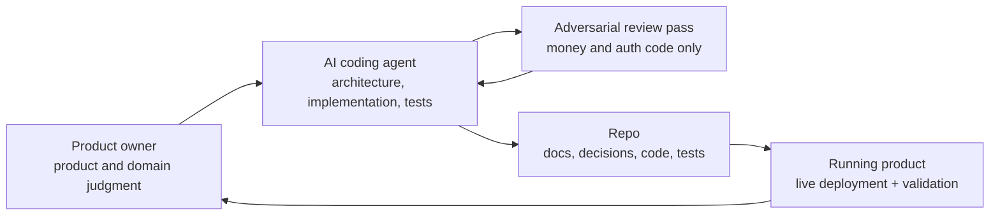

# Operating Model

Project Desk also proves a way of building — and it is largely the same
loop Project Desk itself is built to support for its users.

Wilds uses an AI-assisted engineering loop where product direction,
architecture, implementation, verification, and documentation stay
connected, with a stricter pass required for anything touching money or
authentication.

## The Loop

## Operating Principles

- Product direction and domain judgment stay with a human; execution is
  AI-assisted, not AI-directed.
- Decisions are captured with their reasoning, not just their outcome.
- Any change touching money, authentication, or tenant isolation gets a
  second, adversarial review pass before it ships — find real problems,
  verify them, fix them, review again.
- Running-product validation matters more than abstract confidence: a
  change is not done until it is verified live.
- Documentation and a truthful record of decisions are part of "done," not
  an afterthought.

## Why This Is Proof

The adversarial-review discipline specifically has caught real, shippable
bugs in money and authentication code before they reached production —
including a client-side payment-tier bypass and a migration that would have
force-disconnected every existing user on deploy. Those are the kind of
defects that are easy to introduce quickly with AI-assisted development and
easy to miss without a deliberate second pass looking for them.

That operating model — not just the product it produced — is part of the
asset.
