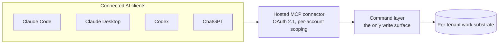

# Platform Architecture

Atlier is designed as a platform, not a single application. Project Desk is
the first product built on it — a hosted, agent-native work desk reachable
through a standard MCP connector.

## Layers

| Layer | Job |
| --- | --- |
| Atlier platform | accounts, per-tenant isolation, the command/event write surface, OAuth 2.1 authorization server |
| Project Desk | the work-desk product: projects, queues, a project Shape, handoffs |
| Hosted MCP connector | a standard, stateless streamable-HTTP MCP server any compatible AI client can connect to |
| Connected clients | the human's own AI tools — Claude Code, Claude Desktop, Codex, ChatGPT, or any MCP-capable client |

## Architecture Shape

## Design Rule

The command layer is the only path that ever changes what is true on a
user's desk. A human working through the web UI and an AI agent working
through the MCP connector both write through the same path, under the same
tenant-isolation and validation rules. There is no second, competing write
path.

## Deployment Posture

The platform is Azure-first:

- backend as a managed web service
- multi-tenant Postgres as the durable store
- GitHub Actions for deployment, gated on an automated verification pass
- environment configuration outside source control
- production source remains private

This proof repo intentionally avoids real resource names and deployment
workflow files.

## Why This Matters

A work desk that reflects AI-agent activity fails if the desk and the agent
can ever disagree about what is true. Project Desk's single-write-surface
design exists specifically to prevent that — one substrate, one path to
change it, read consistently by every connected surface.
