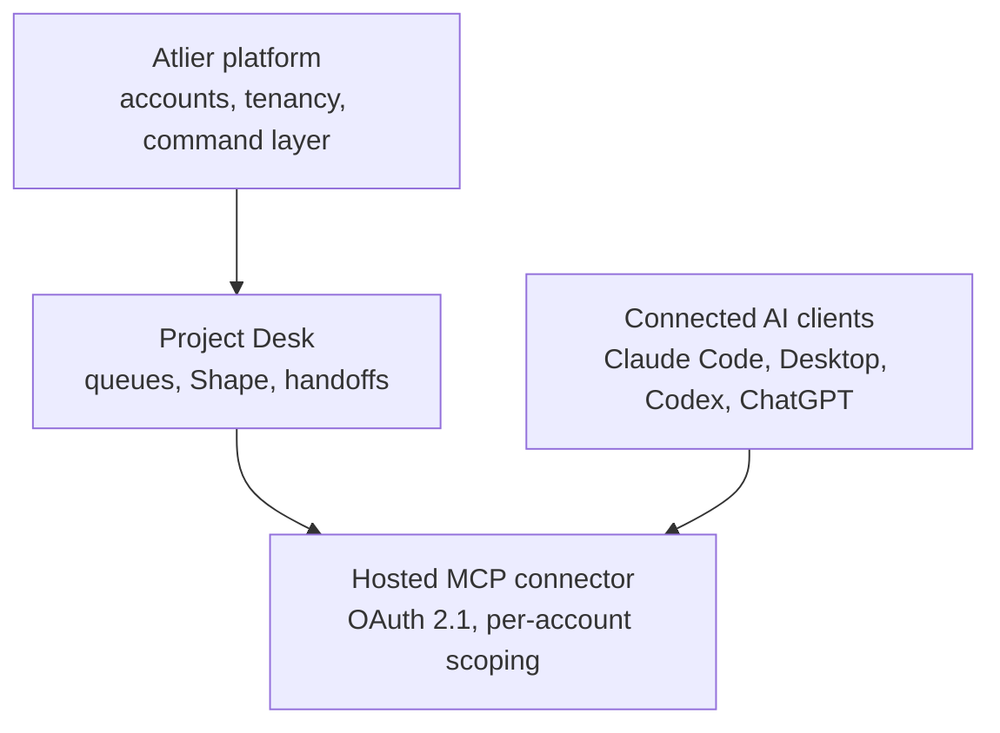

# Project Desk Proof

Curated technical proof artifact for Project Desk, an agent-native work desk
built on the Atlier platform, by Wilds, Inc.

This repository is intentionally **not** the production source tree. It is a
public-reviewable architecture and product-thinking artifact that shows the
platform shape, tenancy model, operating discipline, and reflective-layer
direction without exposing the commercially valuable core implementation.

## How To Read This Repo

Start here if you are evaluating Justin Wilds or Project Desk technically:

1. Read [WHAT_THIS_PROVES.md](WHAT_THIS_PROVES.md) for the short evaluator view.
2. Read [PLATFORM_ARCHITECTURE.md](PLATFORM_ARCHITECTURE.md) for the platform shape.
3. Read [SECURITY_AND_TENANCY.md](SECURITY_AND_TENANCY.md) for the public-safe
   security posture.
4. Read [ADR_DIGEST.md](ADR_DIGEST.md) for decision discipline.
5. Read [OPERATING_MODEL.md](OPERATING_MODEL.md) for the agentic build loop.
6. Read [PUBLIC_BOUNDARY.md](PUBLIC_BOUNDARY.md) before asking why production
   internals are not here.

## What Project Desk Demonstrates

Project Desk is a hosted, multi-tenant work desk for people directing AI
coding agents across real projects:

- a hosted MCP connector (OAuth 2.1, dynamic client registration) that any
  MCP-capable AI client can connect to
- a command/event architecture with one enforced write surface, so a human UI
  and a connected AI agent are never looking at two different truths
- per-account tenant isolation at the platform layer
- live production billing with a disciplined review process for money-path
  code
- cross-vendor protocol compatibility work — diagnosing and fixing real
  interoperability defects across independently-built AI clients
- Azure-first deployment
- AI-assisted workflow acceleration where it helps the operator, never in
  place of human product judgment

This proof repo deliberately avoids deep detail about the command/event
storage internals, token and session mechanics, billing webhook handling, and
company strategy. Those stay private.

## Platform Map

## Proof Contents

| File | Purpose |
| --- | --- |
| `WHAT_THIS_PROVES.md` | Short evaluator guide: what the repo is evidence for |
| `PLATFORM_ARCHITECTURE.md` | Platform shape and product relationship |
| `ADR_DIGEST.md` | Selected platform-level decisions, sanitized |
| `OPERATING_MODEL.md` | How Wilds builds and hardens software with agents |
| `SECURITY_AND_TENANCY.md` | Account isolation and auth posture at a safe level |
| `REFLECTIVE_LAYER.md` | Strategic direction for agent-native, reflective software without engine details |
| `CODE_EXCERPTS.md` | Small, sanitized platform-level TypeScript excerpts |
| `PUBLIC_BOUNDARY.md` | What this proof repo intentionally excludes |
| `PROOF_REPO_STANDARD.md` | Reusable standard for Wilds public proof repos |

## Evaluator Summary

This repo is evidence of:

- a real, live, hosted multi-tenant product (not a prototype)
- in-house OAuth 2.1 authorization-server implementation
- command/event architecture discipline on a production system
- adversarial-review discipline specifically for money and auth code
- cross-vendor MCP protocol interoperability engineering
- agentic engineering as a repeatable operating model
- disciplined public/private boundaries

## What Is Deliberately Omitted

This proof repo does not include:

- production source code
- endpoint maps sufficient to clone the platform
- database schema or storage internals
- token, session, and billing-webhook implementation detail
- deployment workflows or real resource names beyond the public product URL
- secrets, environment names, or private URLs
- real customer, account, or transaction data
- company strategy, roadmap, or go-to-market detail

## Status

Curated proof artifact. Production Project Desk / Atlier remains private and
live at https://atlier.ai.
